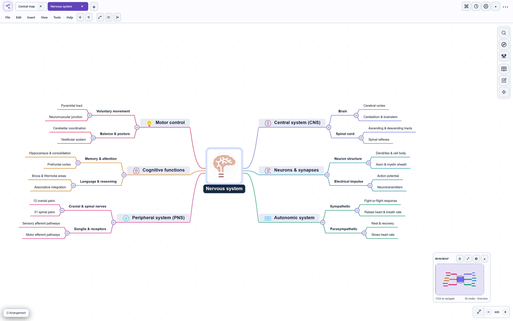
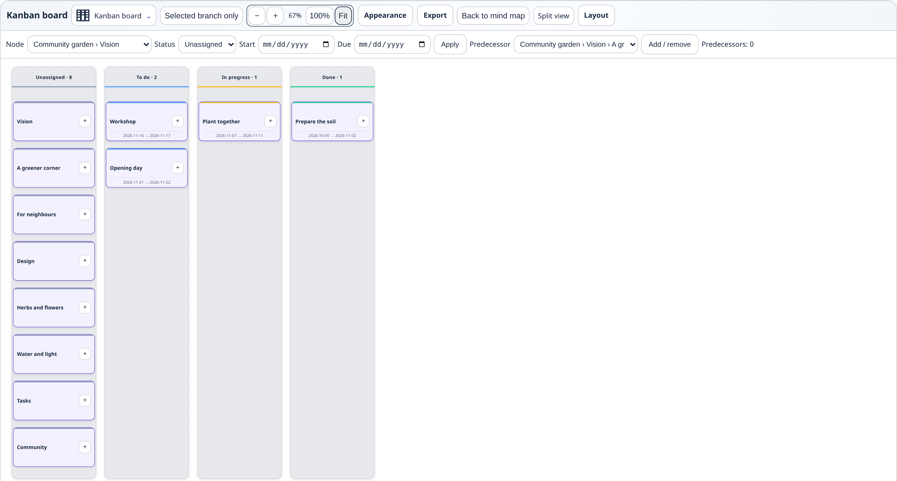
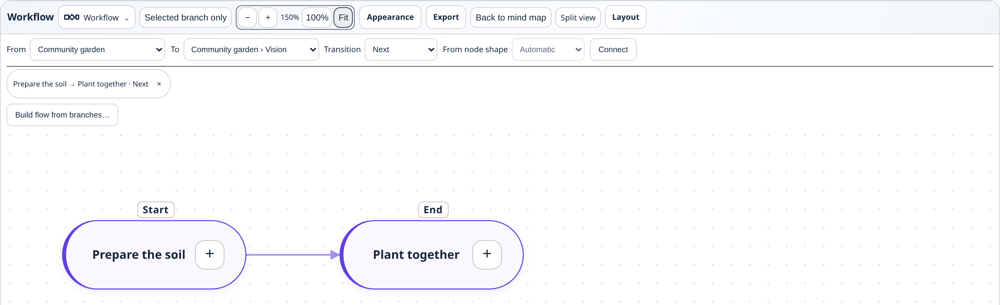
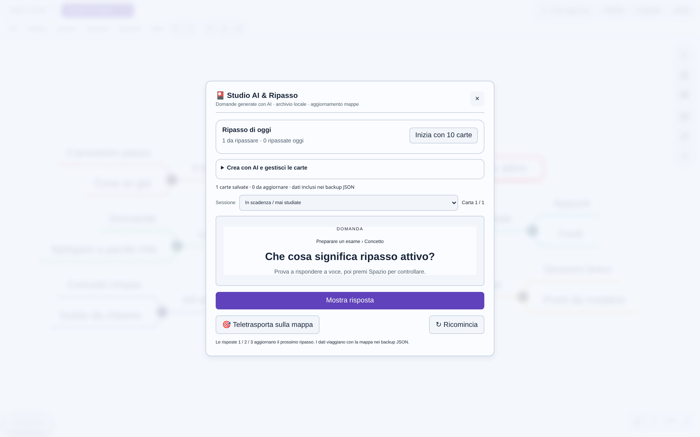
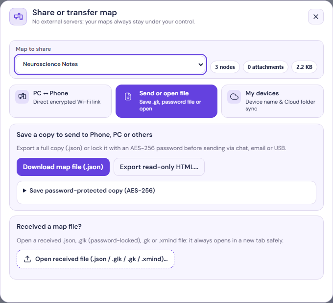

<div align="center">


# Glauka

**Think deeper. Map faster. Sync locally without the cloud.**
An offline-first mind-mapping & multi-view knowledge workspace for Desktop & Android Free.

[](LICENSE)
[](https://github.com/voltessino/glauka/releases/tag/v0.6.22)
[](https://glauka.it)
[](https://github.com/voltessino/glauka)

[**Download Android APK (v0.6.22)**](https://github.com/voltessino/glauka/releases/download/v0.6.22/Glauka-Android-Free-0.6.22-Release.apk) · [**Official Website (`glauka.it`)**](https://glauka.it) · [**Glauka Pro (Windows Store / Site)**](https://glauka.it/#download)

</div>

---

<p align="center">
  
</p>

## Why Glauka?

Most mind-mapping tools force a trade-off between simplicity, layout power, and privacy. **Glauka** opens as a clean infinite canvas on your own device and turns a single `.glk` project into seven synchronized perspectives — with **zero accounts, zero tracking, and zero vendor lock-in**.

- **7 Synchronized Views from One Map**: Switch seamlessly between **Mind Map**, **Org Chart**, **Tree**, **Kanban Board**, **Flowchart**, **Network Graph**, and **Timeline** without duplicating files.
- **Encrypted `PC ↔ Phone` Wi-Fi Pairing**: Share maps directly between desktop and Android over pinned TLS (`QR + 6-digit confirmation`) or password-locked AES-256-GCM `.glk` files.
- **Built-In Active Study**: Create flashcards, spaced-repetition reviews, formulas (MathJax), and structured notes stored right inside your map.
- **100% Local & Private**: Works completely offline on Desktop (Go + WebView) and Android Free. Export cleanly to Markdown, OPML, XMind, PDF, SVG, and PNG.

---

## Visual Tour

<table>
  <tr>
    <td width="50%" align="center">
      
      <br><sub><b>Kanban &amp; Task Organization</b> — organize branches into actionable columns</sub>
    </td>
    <td width="50%" align="center">
      
      <br><sub><b>Flowchart View</b> — automatic structural flow from the same map tree</sub>
    </td>
  </tr>
  <tr>
    <td width="50%" align="center">
      
      <br><sub><b>Active Recall &amp; Flashcards</b> — review material offline alongside your map</sub>
    </td>
    <td width="50%" align="center">
      
      <br><sub><b>Encrypted PC ↔ Phone Handoff</b> — QR pairing &amp; AES-256-GCM packets</sub>
    </td>
  </tr>
</table>

---

## Open Source Core vs. Glauka Pro

Glauka uses an **Open Core + Dual-License** model: everything required to build, study, organize, and securely share maps stays **Open Source (`AGPL-3.0`)** here, while the optional AI suite funds development under **Glauka Pro**.

| Capability | Glauka Open Source (`AGPLv3`) | Glauka Pro (`Microsoft Store` / `glauka.it`) |
| :--- | :---: | :---: |
| Infinite Canvas & 7 Synchronized Views | ✅ Included | ✅ Included |
| AES-256-GCM `.glk` & LAN `PC ↔ Phone` QR Sync | ✅ Included | ✅ Included |
| On-Device OCR, Flashcards, MathJax & Exports | ✅ Included | ✅ Included |
| Android Free APK ([v0.6.22 Release](https://github.com/voltessino/glauka/releases/tag/v0.6.22)) | ✅ Included | — |
| **AI Studio** (Map Gen, Expand, Q&A over PDF, Voice Dictation) | ❌ Excluded | ✅ Proprietary (BYOK) |
| **Studio Vocale** (Neural HD, Online TTS & Glauka Studio Connector) | ❌ Excluded | ✅ Proprietary |

---

## Repository Structure

```text
├── packages/
│   ├── map-core/         # Pure tree algorithms, balanced layouts, serializers
│   ├── map-sharing/      # AES-256-GCM encrypted handoffs & LAN peer protocol
│   ├── cloud-sync/       # Revision conflict detection & local storage queues
│   └── editor-ui/        # Modular canvas, 7 views, study tools & localization
├── apps/
│   ├── desktop-shared/   # Go local runtime, file recovery & pinned LAN TLS bridge
│   └── android/          # Android Free WebView shell & Java platform bridges
└── scripts/release/      # Deterministic editor bundling & verification tests
```

## Quick Start & Verification

```bash
# Run core JavaScript test suite
npm test

# Stage Desktop / Android web bundles
python scripts/release/prepare.py windows ./dist/windows
python scripts/release/prepare.py android ./dist/android

# Run Go native backend tests
cd apps/desktop-shared/src && go test ./...
```

---

## License, Dual-Licensing & Trademarks

- **Source Code:** Licensed under **GNU AGPLv3** ([`LICENSE`](LICENSE)). Any modified version distributed or served over a network must disclose its full modified source under AGPLv3.
- **Commercial Licensing:** Dedicated commercial licenses without AGPLv3 copyleft obligations are available through **Glauka** (`glauka.app@outlook.com`) — see [`TRADEMARK.md`](TRADEMARK.md).
- **Contributing:** Pull requests are welcome under the terms of [`CLA.md`](CLA.md).
- **Trademarks:** The *Glauka* name, logo, and official release signatures remain exclusive property of their owner ([`TRADEMARK.md`](TRADEMARK.md)).
