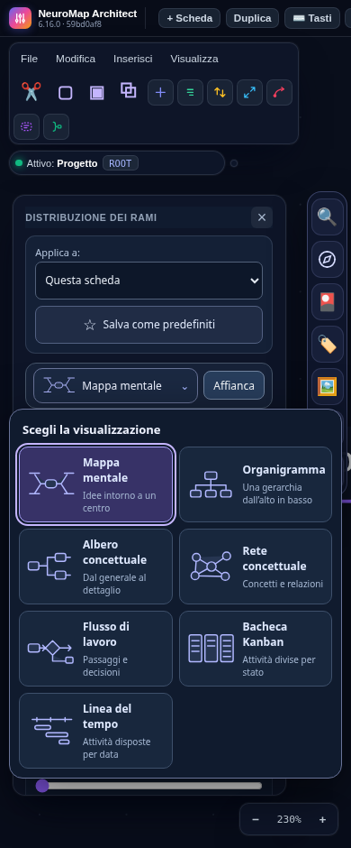
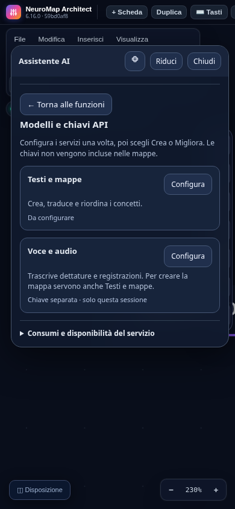

# Anteprime delle viste e configurazione AI — 21 ottobre 2026

Base aggiornata a `ee5672f` su main, comprese rete concettuale, conversione guidata e vista affiancata (PR 32–34). Sorgenti applicativi finali: `59bd0af`. Nessuna GitHub Actions avviata; versione 6.16.0 invariata.

## Interfaccia

- Il selettore delle viste ora presenta sette anteprime vettoriali: mappa mentale, organigramma, albero concettuale, rete, flusso, Kanban e timeline. Ogni opzione mostra nome, miniatura e una descrizione breve.
- Lo stesso componente viene usato nel pannello Disposizione e nel diagramma, anche affiancato. Selezione attiva evidente, tastiera, Esc, ritorno del focus e menu esterno alle aree di scorrimento. È previsto un funzionamento alternativo per browser senza Popover API.
- Nell'AI restano due azioni principali, **Crea** e **Migliora**. L'ingranaggio **Modelli e chiavi API** apre la configurazione separata.
- **Testi e mappe** e **Voce e audio** hanno schede coerenti, entrambe con **Configura**. I due editor mantengono le rispettive funzionalità: provider, modelli, protocolli/endpoint e test di connessione per i testi; modello vocale, lingua e riuso della chiave per la voce.
- Le configurazioni mostrano dati inseriti e necessità di configurazione, senza dichiarare verificata una connessione mai provata. Sono ammessi anche endpoint personalizzati/locali senza chiave.
- Voce e audio usa Salva per confermare, Annulla/Esc per ripristinare. Le preferenze del servizio persistono; la chiave voce resta in memoria e non entra nei progetti. Il riuso della chiave testi richiede lo stesso provider. Trascrizioni e anteprime rimangono disponibili tornando alle azioni.
- Corretto l'ordine dei pannelli: le finestre di configurazione si aprono sopra l'assistente. Rimosso il messaggio di annullamento quando non c'era un'operazione in corso.

## Bug degli ultimi sviluppi corretti

Tre regressioni sono state riprodotte con test falliti prima della correzione:

1. **Posizioni della rete perse alla riapertura:** `networkPosition` veniva conservato negli snapshot ma non nell'importazione del singolo progetto. La validazione passa ora dalla funzione condivisa dei metadati, usata da entrambe.
2. **Kanban affiancato:** il drop controllava `root.viewMode`, che resta `mindmap` nell'affiancamento. Ora usa la modalità effettivamente visualizzata, come l'esportazione.
3. **Rinomina affiancata:** il contesto dell'editor registrava `mindmap` invece della vista affiancata, così un ridisegno chiudeva prematuramente l'editor. Ora conserva la vista effettiva.

I test della vista affiancata aprono ora realmente il pannello Disposizione prima di premere Affianca: precedentemente tentavano di cliccare un controllo nascosto. I test del cambio vista usano il nuovo selettore illustrato.

## Verifiche locali

Host Linux, Chromium. Le finestre sono state ispezionate anche a 390 px di larghezza.

| Controllo | Risultato |
| --- | --- |
| Test Node | 104/104 |
| Test composizione/build | 15/15, incluso editor identico Windows/macOS e presenza del nuovo selettore |
| Prima verifica delle interazioni esistenti AI, lingua, viste e affiancamento | 81/81 |
| Anteprime, configurazioni e nuovi bug con rete/flussi/affiancamento | 19/19 dopo le correzioni |
| Suite browser generale | 718 superati; 4 verifiche invalidate dal disallineamento fra test e copia UI del run, poi rieseguite nel gruppo finale |
| Verifica finale dopo Salva/Annulla voce e rifiniture UI | 78/78, inclusi tutti e quattro i casi da rieseguire |
| Backend Go reale, casi desktop della nuova UX | 9/9 |
| Windows | Setup/Portable compilati dal commit pulito `59bd0af`, editor incorporato verificato |
| macOS | backend amd64/arm64 compilati dal commit pulito `59bd0af`, editor incorporato verificato |

I gruppi si sovrappongono. Due titoli di test sono stati modificati durante la suite generale e due nuovi controlli hanno incontrato la copia UI precedente: quel run non viene dichiarato 722/722. Tutti e quattro sono inclusi nella successiva esecuzione finale 78/78. La suite generale è stata avviata prima delle ultime rifiniture del dialogo voce e del pulsante di configurazione; queste sono coperte dalle successive verifiche finali. Per Kanban, il trascinamento completo viene verificato nella vista intera; il caso affiancato verifica la sequenza HTML5 drag/drop sul nodo originale e Undo.

Le anteprime desktop e le correzioni delle viste sono condivise da Windows e Mac. Il pannello AI è condiviso anche con Android ed è verificato nel browser per entrambe le interfacce. Non sono state introdotte nuove richieste AI automatiche o dipendenze di rete per le miniature.

Restano da verificare installazione/esecuzione Windows reale e app macOS/WebKit. DMG, firma e notarizzazione richiedono un Mac; le compilazioni locali dei backend non sostituiscono questa prova. Nessuna credenziale, chiave o binario di rilascio è incluso nei commit.
