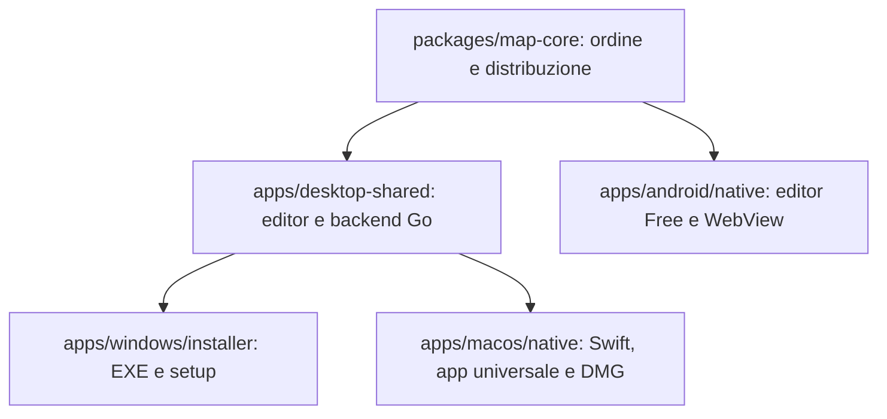

# Struttura del progetto

Glauka usa un monorepo privato: una revisione identifica l'editor e tutte le app. Non occorre creare altri repository per sviluppare o rilasciare le tre piattaforme.

## Dove intervenire

Per trovare il **sorgente esatto a partire dal problema** (nodi, layout, Cloud, OCR, Android, build), aprire prima la [mappa operativa del codice](CODE_NAVIGATION.md). Le cartelle dei due editor hanno anche guide locali: [desktop](../apps/desktop-shared/editor/README.md) e [Android](../apps/android/editor/README.md). Per gli agenti di sviluppo valgono le [istruzioni root](../AGENTS.md).

| Modifica | Percorso |
| --- | --- |
| Ordine dei rami, distribuzione e navigazione visiva comuni | `packages/map-core/index.js` |
| Componenti UI condivisi: palette degli sfondi | `packages/editor-ui/` |
| Editor desktop condiviso | `apps/desktop-shared/editor/` (JS e CSS), `src/resources/index.html` (struttura HTML) |
| Salvataggi e backend desktop | `apps/desktop-shared/src/*.go` |
| Integrazione nativa per OS | File Go con suffisso `_windows.go` / `_darwin.go` e build tag |
| Installazione Windows | `apps/windows/installer/` e `apps/windows/tests/` |
| Finestra e bundle Mac | `apps/macos/native/` |
| Android nativo e Gradle | `apps/android/native/` |
| Editor e menu touch Android | `apps/android/editor/` (editor), `native/app/src/main/assets/assets/` (touch) |
| Importazioni Android senza dipendenze UI | `smart-import-core.js` e `apps/android/tests/` |
| Composizione dei sorgenti per la build | `scripts/release/prepare.py` |
| Versioni e compatibilità | `versions.json` e `docs/PLATFORM_PARITY.md` |

I sorgenti Windows e Mac non sono due copie: lo staging usa lo stesso backend, lo stesso HTML e lo stesso modulo comune. I file specifici vengono selezionati da Go tramite build tag. La UI Android resta Free e distinta dalla Developer; gli algoritmi comuni non contengono attivazioni, bridge nativi o accessi di rete.

## Sorgenti e output

`prepare.py` richiede una directory nuova esterna al checkout e rifiuta di sovrascriverne una esistente. Copia i sorgenti, compone il modulo comune e aggiunge solo i file nativi necessari. Modificare sempre i file nel checkout, mai la copia temporanea.

Le basi originali compresse che erano nelle directory `legacy/` sono ora conservate nella cronologia Git e non più nel checkout corrente. Per recuperarle consultare il [registro dei blob storici](maintenance/legacy-source-archives.json) con SHA e commit di origine. Non erano input delle build. Per ricostruire una vecchia release usare il relativo commit Git e i suoi workflow.

## Composizione dell’editor

Le directory `apps/desktop-shared/editor/` e `apps/android/editor/` separano stato,
layout, renderer, import/export, controller, client AI e interazioni. `sources.json`
indica l’ordine di concatenazione; `startup.js` installa gli strumenti dopo le classi
e le estensioni. I file mantengono lo stesso ambito JavaScript: non sono moduli ES.
Le estensioni storiche dei prototipi restano ordinate per preservare il comportamento;
la separazione in file non elimina ancora tutte queste dipendenze.

Il prefisso `shared/` nei due manifest risolve esclusivamente i file di
`packages/editor-ui/editor-shared/`: ricerca/camera, flashcard e helper delle
icone hanno una sola copia canonica. Il prefisso non cambia l'ordine di
concatenazione né introduce moduli ES; percorsi arbitrari non sono ammessi.

`packages/editor-ui/editor-colors.js` contiene palette e conversioni colore comuni.
`packages/map-core/index.js` conserva una cache limitata a 256 etichette corte per
ridurre le misurazioni ripetute del testo, senza condividere array modificabili.
Contiene anche `findNodesById`, ricerca multipla in un solo attraversamento senza
cache persistente fra modifiche, e `serializeOPML`, serializer comune usato dai due `io.js`; download,
notifiche e salvataggi restano nei rispettivi adapter di piattaforma.

`packages/editor-ui/graphics.js` gestisce le misure intrinseche condivise e il loro
riuso verificato nelle copie di anteprima, l'indice di selezione limitato al frame
e la liberazione dei raster di mappe chiuse. Il cache di immagini rimane nel
contesto editor di `editor-colors.js`; i due renderer espongono lo stesso adapter.

Lo staging incorpora JS e CSS nell’HTML desktop e genera `assets/architect.js` su
Android. Non aggiunge richieste di rete o URL al WebView. L’HTML sorgente desktop e
il segnaposto `architect.js` non vanno distribuiti senza `prepare.py`.

## Git e rilasci

`main` è la base integrata. Le modifiche attraversano una pull request con test dell'editor e le build delle piattaforme coinvolte. Non cancellare rami o cronologia per nascondere build precedenti. Un artefatto deve identificare il commit dei sorgenti e le verifiche locali o CI eseguite. Non committare binari di rilascio, cache, profili utente o credenziali.

Per criteri di nomenclatura, conservazione e verifica prima della cancellazione dei rami vedere [Politica Git](GIT_WORKFLOW.md) e [Inventario del 21 ottobre 2026](BRANCH_INVENTORY_2026-10-21.md).

## Montaggio dell'interfaccia AI

`packages/editor-ui/ai-studio.js` conserva classe, richieste, cancellazione,
quote, anteprima e applicazione alla mappa. `ai-studio-mount.js` contiene solo
il corpo originale di `Studio.mount()`: **è un frammento di composizione**, non
uno script da caricare o eseguire autonomamente. `prepare.py` lo inserisce nel
singolo marker, prima di incorporare il CSS. Rimangono identici ambito lessicale,
chiusure, ordine degli eventi e JavaScript distribuito. Non aggiungere un secondo
`<script>` o un'importazione runtime di questo frammento.

### Frammenti lessicali dei controller

I due `app-tabs.js`, `app-selection-clipboard.js`, `app-context-find.js` e
`app-bind-ui.js` sono corpi di metodi inseriti nelle classi dei rispettivi
`app.js`. `creative-settings-values.js`, `linked-view-styles.js` e
`linked-view-export.js` sono inseriti nelle IIFE proprietarie. `prepare.py`
richiede un solo marcatore per ciascun inserimento:
non sono nuovi script, moduli ES o estensioni del prototipo e non modificano
l'ordine di `bindUI()`. Il comparatore con `--include-ui-fragments` copre anche
queste due IIFE, prima delle sostituzioni CSS/font invariate.

**OCR 2.0 condiviso:** `apps/desktop-shared/editor/ocr-structure.js` analizza geometria/testo e valida proposte transitorie; lo staging lo include nel caricamento OCR lazy Android. Non cambia il formato delle mappe. Benchmark/MicroLab isolati in `scripts/qa/ocr2_*.cjs`; stato in [GLAUKA_OCR_2.md](roadmap/GLAUKA_OCR_2.md).
